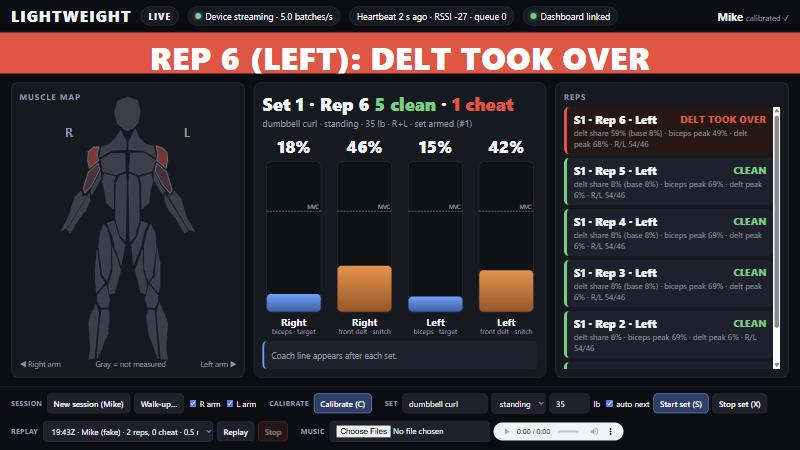
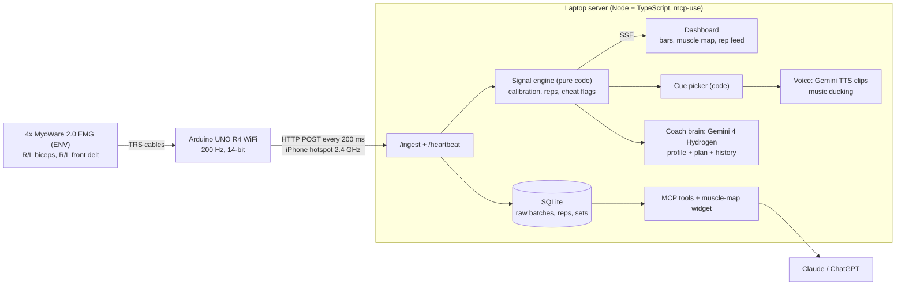

# Lightweight

**A wearable that lets an AI coach feel your muscles and call out your cheat reps out loud. Try to beat it.**

Demo video: _TODO: link_


<sub>Dashboard during a no-hardware run (`scripts/fake-device.ts`, synthetic data): 5 clean curls, then the swing on rep 6 gets flagged.</sub>

## What it does

- **Feels the lift.** Four MyoWare 2.0 EMG sensors read the left and right **biceps** (the target) and the left and right **front delts** (the cheat check) at 200 Hz.
- **Catches the swing.** When you swing a curl up, your front delt starts the weight. The signal engine compares each rep's up phase with your own clean reps and flags the cheat ("delt took over").
- **Calls it out loud.** A voice coach (Gemini TTS, voice *Alnilam*) says "Rep six. Your delt took over." over your music, ducking the music while it talks. Call-outs are pre-generated clips, so there's no waiting on an API mid-set.
- **Knows you.** A coach brain (**Gemini 4 Hydrogen**) gets one context packet: your profile, your plan (35 lb stays 35 lb; progress means more clean reps), today's sets and your last session. After each set it gives a one or two sentence summary.
- **Lets Claude see your body.** An MCP server (mcp-use) exposes your reps, sets, L/R balance and history as tools, plus a **muscle-map widget**: a front-body map with the four sensed muscles shaded by effort and a per-rep scrubber.

## The proof (real recordings)

Three real recordings, replayed through the engine in `server/tests/engine-real.test.ts` (all green). Raw CSVs are in `data/coach/history/raw/`.

| Recording | Strict reps | Swing reps | What separates them |
|---|---|---|---|
| Nov 13, band curls, right arm | 3 reps, **0 flagged** | 4 reps, **3 flagged** | delt share per rep: **0.093–0.098** strict vs 0.22–0.66 swing (mean **0.48**) |
| Nov 14, 35 lb dumbbell, right arm | 5 reps, **0 flagged** | 3 reps, **3 flagged** | up-phase delt/biceps ratio: **0.41–0.76** strict vs **1.04–1.31** swing |
| Nov 14, 35 lb dumbbells, both arms | 7 reps, **0 flagged** | 6 reps, **5 flagged** | right delt mean %MVC: 0.45–0.52 strict vs 0.75–0.86 swing |

Why the up phase: on heavy strict curls the front delt works too, but mostly on the way *down*, to hold the shoulder still. A swing fires it on the way *up*. Whole-rep numbers blur the two under load (35 lb: delt share 0.35–0.46 strict vs 0.51–0.54 swing). The up-phase ratio separates them (worst strict rep 1.08× its reference, weakest swing 1.47×, threshold 1.35×). The one unflagged swing rep in each recording was a light swing at strict-level delt effort. Details: [`server/src/engine/README.md`](server/src/engine/README.md).

## Architecture



Every raw batch is stored, so any session can be **replayed** through the same pipeline at real speed. The dashboard, voice and MCP tools behave exactly as if it were live, which makes a replay the demo fallback.

## Hardware

| Qty | Part |
|---|---|
| 4 | SparkFun MyoWare 2.0 Muscle Sensor (DEV-27924), output on **ENV** |
| 4 | MyoWare 2.0 Link Shield (DEV-18425) + 1 m 3.5 mm TRS cable |
| 1 | MyoWare 2.0 Arduino Shield (DEV-18426) |
| 1 | Arduino UNO R4 WiFi (ABX00087) |
| 3 per sensor | 24 mm snap electrodes (single use) |
| 1 | USB-C power bank: **on-body electronics run on battery only** |
| 1 | Bluetooth speaker (coach voice + music) |

No soldering: everything snaps, plugs or stacks. Channel map: A0 R biceps, A1 R front delt, A2 L biceps, A3 L front delt. Placement and setup: [`HARDWARE-SETUP.md`](HARDWARE-SETUP.md).

## Run it

### Server (works without hardware)
```bash
cd server
npm ci --prefer-offline   # on Windows without Visual Studio: add --ignore-scripts (better-sqlite3 ships prebuilt binaries)
npm run dev               # http://localhost:3000/  (dashboard), /mcp (MCP), /inspector (mcp-use inspector)
```
Put `GEMINI_API_KEY=...` in a `.env` at the repo root for voice and coach lines. The first start generates the voice clips (~80 s), and later starts load them from `server/.cache/voice/`. Without a key, the dashboard and engine still work: the coach falls back to code-written lines, and the dashboard uses browser speech if the voice player is missing. Add `?mute=1` to the dashboard URL to log call-outs instead of playing them.

**No-hardware run:** a synthetic UNO does a calibration, 5 clean curls, then 3 swings:
```bash
npx tsx scripts/fake-device.ts            # flags: --arms R, --clean N --swing N, --loop, --raw
```

**Replay** a recorded session: pick it in the dashboard's Replay box, or
```bash
curl -X POST "http://127.0.0.1:3000/replay/<session_id>?speed=1"   # session ids: GET /sessions
```

**Tests:** `npm test` (engine on the 3 real recordings, synthetic fixtures, coach, voice) and `npm run typecheck`.

### Firmware
```bash
cp firmware/lightweight/arduino_secrets.example.h firmware/lightweight/arduino_secrets.h   # Wi-Fi SSID/password, LAPTOP_IP (hotspot: 172.20.10.2), port 3000
arduino-cli compile --fqbn arduino:renesas_uno:unor4wifi firmware/lightweight
arduino-cli upload -p COM8 --fqbn arduino:renesas_uno:unor4wifi firmware/lightweight      # electrodes OFF the skin while on USB
```
The UNO is 2.4 GHz only, so use a phone hotspot. It samples in a timer interrupt, POSTs 40-sample batches every 200 ms, queues ~8.6 s offline and sends a heartbeat every 2 s. More detail: [`firmware/README.md`](firmware/README.md).

### Connect Claude (MCP)
The MCP endpoint is `http://localhost:3000/mcp` (streamable HTTP, stateless). For example, with Claude Code:
```bash
claude mcp add --transport http lightweight http://localhost:3000/mcp
```
Tools: `start_session`, `log_exercise`, `get_reps`, `show_last_set` (muscle-map widget), `compare_arms` (widget), `compare_curls`, `challenge_status`, `get_coach_context`, `get_history`, `update_plan`. Ask: *"Which rep did I cheat, and which arm is weaker?"* We tested the tools and the widget in the mcp-use inspector (`/inspector`).

The server only accepts `/ingest` and `/heartbeat` from the network (the UNO). Everything else (dashboard, control routes, MCP) answers to this laptop only.

## Design rules

- **Code decides, the LLM explains.** Thresholds in `server/src/engine/config.ts` flag reps, and code picks the call-out clips and the set decision. Gemini only phrases them and answers questions, and it is never asked whether a rep was a cheat. A coach line that suggests changing the weight is replaced by a code-written one.
- **Relative, not medical.** Readings are %MVC from a 15-second calibration (relax, then flex each muscle), plus shares between muscles. Not force, not muscle growth, not a medical device.
- **Walk-ups don't get Mike's coaching.** A walk-up gets a blank coach profile, a generic plan and no history, and their sets are never written into Mike's history.
- **Honest map.** Only the four sensed muscles get shaded; everything else on the body map stays gray. Hammer curls use the forearm, which we don't sense, so the coach says "less biceps", never "forearm took over".

## Built at VexoHacks

Built solo in one day at **VexoHacks, November 14, 2026**, with **Claude Code** (parallel sessions for firmware, signal engine, server and voice/coach) and **Google Gemini** (Gemini 4 Hydrogen for the coach, Gemini TTS for the voice). Muscle-map body art is from [react-body-highlighter](https://github.com/GV79/react-body-highlighter) (MIT, license in `assets/muscle-map/`).
